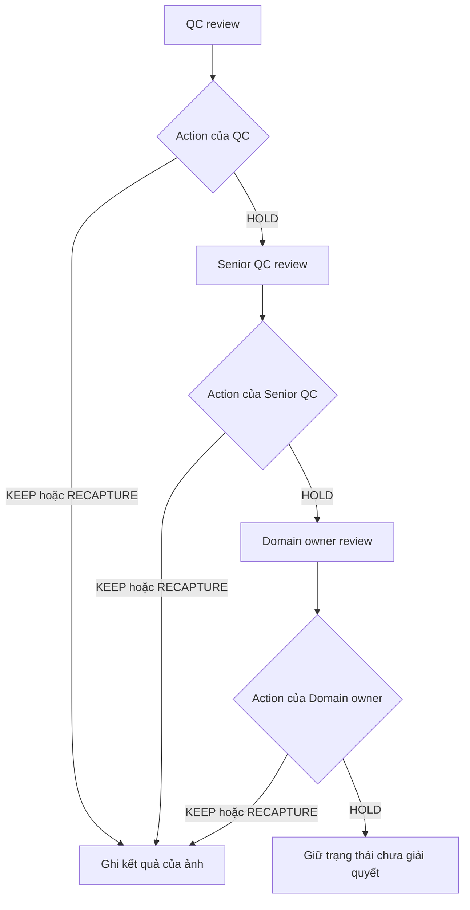

# Workflow T02 — Raw QC Triage

Tài liệu giúp thành viên mới hiểu workflow đã triển khai của nhóm G02: từ dữ liệu ảnh đầu vào đến xếp hạng, review qua từng cấp, audit và quyết định cuối cho queue. Hướng dẫn cài môi trường nằm trong [ONBOARDING_T02.md](ONBOARDING_T02.md).

## 1. Phạm vi và nguyên tắc

T02 hỗ trợ annotator/QC ưu tiên ảnh nghi mờ, tối, lóa hoặc lỗi nén. Công cụ tính điểm và gợi ý; người kiểm tra quyết định giữ ảnh, yêu cầu chụp lại hoặc chờ xử lý.

- Fixture đang dùng: 96 ảnh synthetic, gồm 56 ảnh dev và 40 ảnh eval theo tài liệu nhóm.
- Dev phục vụ hiệu chỉnh ngưỡng và chuẩn hóa; không tune bằng nhãn eval.
- Xếp hạng đủ ảnh đầu vào nhưng chỉ chọn top-20 từ split eval vào queue QC.
- Score là độ ưu tiên review, không phải xác suất lỗi.
- Chạy offline với seed 42; pipeline không đọc ground truth.
- Quyết định GO/HOLD/REWORK chỉ áp dụng queue eval top-20, không phê duyệt toàn batch.

## 2. Các thành phần phụ trách workflow

| Thành phần | Trách nhiệm |
|---|---|
| `src/main.py` | Điểm chạy chung, cấu hình lượt chạy và các guard |
| `configs/lab.yaml` | Chọn track, input, owner, group, seed và chế độ offline |
| `src/pipeline.py::load` | Đọc metadata, kiểm tra ID và provenance |
| `src/pipeline.py::process` | Đo đặc trưng và tính score PoC |
| `src/pipeline.py::process_baseline` | Tính score baseline Laplacian |
| `src/pipeline.py::rank` | Chọn top-B eval, gắn stage và queue ID |
| `src/pipeline.py::review` | Sinh HTML/CSV, nhập review và chuyển cấp HOLD |
| `src/pipeline.py::decide` | Tổng hợp quyết định cuối của queue |
| `src/common/review.py` | Xác thực CSV review và ghi audit JSONL |
| `src/common/contact_sheet.py` | Giao diện HTML review offline và export CSV |
| `src/common/decision.py` | Cấu trúc và ghi quyết định |
| `src/evaluate.py` | Đánh giá bằng GT khi được cung cấp hợp lệ |

## 3. Bước 1 — Đọc input và kiểm tra provenance

Input mặc định là `fixtures/t02_raw_qc/`, gồm ảnh, `images.csv` và `manifest.csv`.

`images.csv` phải có các cột:

| Cột | Ý nghĩa |
|---|---|
| `image_id` | ID duy nhất của ảnh |
| `path` | Đường dẫn ảnh |
| `camera_id` | Camera của ảnh |
| `light` | Điều kiện ánh sáng |
| `split` | Tập dev hoặc eval |

Pipeline kiểm tra cột bắt buộc, ID rỗng/trùng, đường dẫn rỗng, manifest/hash và việc ảnh có được liệt kê trong manifest hay không. Khi xử lý từng ảnh, đường dẫn được kiểm tra để không thoát ra ngoài thư mục input; ảnh phải tồn tại và đọc được.

Với `strict_provenance: true`, lỗi provenance được ghi audit và làm dừng lượt chạy. Không sửa manifest hoặc tắt kiểm tra để che lỗi dữ liệu. Ground truth không phải input của pipeline này.

## 4. Bước 2 — Đo đặc trưng và tính score

### 4.1. Baseline Laplacian

Baseline chạy bằng module `src.baseline_t02`, dùng phương sai Laplacian toàn ảnh. Ngưỡng lấy từ phân vị dev, mặc định q25; phương sai thấp hơn ngưỡng nhận score nghi mờ cao hơn.

```text
threshold = quantile(Laplacian_dev, baseline_quantile)
span = max(threshold - min(Laplacian_dev), 1e-12)
score = clip((threshold - Laplacian_image) / span, 0, 1)
```

Ảnh có Laplacian từ ngưỡng trở lên nhận score 0. Khi đồng điểm, thứ tự đầu vào được giữ ổn định; không diễn giải nhóm đồng điểm như các mức lỗi khác nhau.

`make baseline TRACK=t02` trong Makefile mẫu gọi random baseline, không phải baseline Laplacian dùng trong phần này.

### 4.2. PoC đa đặc trưng

| Tín hiệu | Đặc trưng trong code | Chiều nghi lỗi | Trọng số |
|---|---|---|---|
| Blur | `laplacian_variance` | Thấp | 0.35 |
| Dark | `frac_dark` | Cao | 0.20 |
| Glare | `glare_local_saturated_max` | Cao | 0.30 |
| Compression | `jpeg_blockiness` | Cao | 0.15 |

Mỗi đặc trưng được chuẩn hóa bằng phân bố dev thành risk trong [0,1]. Blur dùng phần đuôi dưới q25; các tín hiệu còn lại dùng phần đuôi trên q75. Hàm `_tail_risk` xử lý riêng trường hợp khoảng chuẩn hóa bằng hoặc gần 0.

```text
score = 0.35 × risk_blur
      + 0.20 × risk_dark
      + 0.30 × risk_glare
      + 0.15 × risk_compression
```

PoC hiện chuẩn hóa toàn cục trên dev, chưa chuẩn hóa riêng theo camera hoặc ánh sáng. Các trọng số là heuristic trong code, không phải kết quả đã chứng minh tối ưu.

Output trung gian gồm:

- `score`: điểm xếp hạng.
- `pred_defect_type`: tín hiệu có risk lớn nhất trước khi nhân trọng số; `none` nếu các risk đều bằng 0.
- `reason`: các risk dương và giá trị tương ứng để giải thích.
- `pred_action`: `REVIEW` nếu score > 0, còn lại `KEEP`.

`pred_action` chỉ là gợi ý máy. Nó không được coi là quyết định KEEP của reviewer. Không có ảnh dev hoặc có đặc trưng/score không hữu hạn thì pipeline báo lỗi.

## 5. Bước 3 — Xếp hạng và tạo queue QC

`rank()` thực hiện:

1. Kiểm tra ID duy nhất và mỗi ảnh có một score số hữu hạn.
2. Lấy pool thuộc `eval_split`, mặc định `eval`.
3. Kiểm tra budget dương và pool có đủ ảnh cho budget.
4. Sort score giảm dần bằng `mergesort`, giữ thứ tự khi đồng điểm.
5. Chọn top-B, mặc định B=20; gắn `review_stage=qc`, `queue_id`, rank và đường dẫn bằng chứng.

`ranked_review.csv` chứa xếp hạng toàn bộ ảnh, gồm cả dev và eval. `review_queue.csv` chỉ chứa queue top-20 eval. Không lấy 20 dòng đầu của file xếp hạng toàn bộ để thay queue eval.

## 6. Bước 4 — Review và chuyển cấp

### 6.1. Trách nhiệm của người review

Reviewer xem ảnh, lý do máy gắn cờ, ánh sáng, camera và lịch sử review, sau đó chọn:

| Action | Ý nghĩa |
|---|---|
| `KEEP` | Giữ ảnh theo đánh giá của reviewer |
| `RECAPTURE` | Đề nghị chụp lại/làm lại |
| `HOLD` | Chưa đủ căn cứ kết luận; chờ hoặc chuyển cấp |

### 6.2. Luồng chuyển cấp đã cài



Chỉ ảnh có quyết định HOLD đã import mới xuất hiện ở queue cấp tiếp theo. Ảnh chưa được QC review không tự chuyển cấp. Lịch sử, reviewer và ghi chú đi kèm ảnh khi chuyển cấp; không gửi thông báo hay phân quyền tài khoản tự động trong workflow CSV/HTML này.

### 6.3. Các file theo cấp

Các file dưới đây nằm trong thư mục output của lượt chạy, ví dụ `out/poc/`:

| Cấp | Queue do pipeline tạo | HTML review | CSV quyết định để import |
|---|---|---|---|
| QC | `review_queue.csv` | `contact_sheet.html` | `review_queue_reviewed.csv` |
| Senior QC | `senior_review_queue.csv` | `senior_contact_sheet.html` | `senior_review_queue_reviewed.csv` |
| Domain owner | `domain_owner_review_queue.csv` | `domain_owner_contact_sheet.html` | `domain_owner_review_queue_reviewed.csv` |

Queue cấp cao hơn có thể rỗng nếu chưa có HOLD từ cấp trước.

### 6.4. Thao tác nhập quyết định

1. Mở HTML của đúng cấp trong trình duyệt và nhập reviewer.
2. Xem ảnh, chọn action và reason code; bổ sung ghi chú theo quy tắc.
3. Export CSV rồi chép file vào đúng thư mục output, đúng tên ở bảng trên.
4. Chạy lại cùng lệnh pipeline để import CSV, ghi audit và cập nhật queue cấp tiếp theo.
5. Nếu có mục chuyển cấp, lặp lại với HTML/CSV của cấp đó.

Thao tác trên HTML không tự ghi vào pipeline. Phải export rồi import lại. Khi chạy lại, HTML và queue đầu ra được sinh lại; hãy export phần đang làm trước khi chạy lại và giữ các file `*_reviewed.csv` cần thiết qua các lượt.

### 6.5. Quy tắc xác thực CSV

CSV phải giữ đủ cột T02, đúng `review_stage`, `queue_id`, ID thuộc queue và không trùng ID. Thay đổi nội dung queue có thể làm queue ID đổi; không sửa tay ID để ép nhập CSV cũ.

Với mỗi dòng đã chọn action:

- Bắt buộc có reviewer và ít nhất một reason code hợp lệ.
- Reason code cho phép: `blur`, `glare`, `dark`, `compression`, `insufficient_evidence`, `other`, `no_defect`.
- Nhiều mã ngăn cách bằng dấu `;`, không lặp mã.
- `no_defect` chỉ được dùng với KEEP; dùng mã này khi giữ ảnh vì không thấy lỗi.
- HOLD và RECAPTURE bắt buộc có `review_note`; KEEP có thể để trống note.
- `reviewed_at` phải là thời gian ISO-8601 có múi giờ.
- `review_session_seconds` phải là số hữu hạn, không âm.

Dòng chưa chọn action không được tính là một quyết định review hoàn tất.

## 7. Audit và sửa quyết định

`audit_log.jsonl` lưu sự kiện theo dạng append-only, gồm người thao tác, thời gian, ID ảnh, nội dung trước/sau, lý do, stage và queue ID.

- Quyết định đầu tiên được ghi thành `review_decision`.
- Import lại cùng quyết định, cùng reviewer và cùng ngữ cảnh không tạo thêm sự kiện review giống hệt.
- Thay đổi quyết định hợp lệ trong cùng ngữ cảnh được ghi thành `review_override` với trước/sau.
- Lỗi provenance cũng có thể có trong audit; không xem sự tồn tại của audit log là bằng chứng queue đã được con người review.

T02 dùng quyết định của người review để tổng hợp kết quả cuối; không dùng quyết định này để tự sửa score hoặc đổi ranking của máy. Nếu quyết định cấp trước đổi làm queue cấp sau thay đổi, cần kiểm tra/xuất lại CSV của cấp sau cho đúng queue mới.

## 8. Bước 5 — Tổng hợp quyết định queue

Với mỗi ảnh trong queue QC ban đầu, `decide()` lấy quyết định ở cấp cao nhất đã được import. Sau đó áp dụng theo thứ tự ưu tiên:

| Điều kiện của queue | Status | Reason code |
|---|---|---|
| Còn ít nhất một ảnh PENDING hoặc HOLD | `HOLD` | `REVIEW_PENDING` |
| Không còn mục chưa giải quyết và có RECAPTURE | `REWORK` | `QUEUE_RECAPTURE_REQUIRED` |
| Tất cả ảnh trong queue đều KEEP | `GO` | `QUEUE_ALL_KEPT` |

Nếu Domain owner vẫn HOLD, ảnh vẫn chưa được duyệt. Không tự chuyển HOLD thành KEEP hoặc RECAPTURE.

`decision.json` có status, reason, reason code, owner, scope, bằng chứng và số mục keep/recapture/unresolved. `decision_log.csv` lưu lịch sử; `_write_t02_decision()` tránh thêm bản ghi khi chữ ký quyết định giống bản ghi cuối.

**GO chỉ kết luận cho queue eval top-20. Nó không có nghĩa toàn bộ 96 ảnh sạch, không chứng nhận chất lượng model và không phê duyệt phát hành dataset.**

## 9. Chạy workflow và kiểm tra output

Sau khi cài dependency theo onboarding, chạy tại thư mục gốc repo bằng PowerShell:

```powershell
# Baseline Laplacian của nhóm
.\.venv\Scripts\python.exe -m src.main --config configs/lab.yaml --track t02 --pipeline src.baseline_t02 --output out/baseline --run-name baseline --offline --seed 42

# PoC và import review nếu đã có CSV trong out/poc/
.\.venv\Scripts\python.exe -m src.main --config configs/lab.yaml --track t02 --pipeline src.pipeline --output out/poc --run-name poc --offline --seed 42

# Mở giao diện QC của PoC
Start-Process .\out\poc\contact_sheet.html
```

Sau mỗi lần export CSV review, chạy lại lệnh PoC trên để nhập quyết định. Khi cần chuyển cấp:

```powershell
Start-Process .\out\poc\senior_contact_sheet.html
Start-Process .\out\poc\domain_owner_contact_sheet.html
```

| Output | Dùng để kiểm tra |
|---|---|
| `ranked_review.csv` | Ranking toàn bộ ảnh và các gợi ý máy |
| `review_queue.csv` | Top-B eval được ưu tiên QC |
| Các queue/HTML cấp cao hơn | Mục HOLD đã được chuyển cấp |
| `audit_log.jsonl` | Quyết định review và thay đổi có dấu vết |
| `decision.json` | Kết luận hiện tại và phạm vi áp dụng |
| `decision_log.csv` | Lịch sử kết luận queue |
| `run_info.json` | Thông tin lượt chạy do runner ghi |

Nếu chưa có CSV review, HOLD/REVIEW_PENDING phản ánh trạng thái chờ con người, không phải lỗi thực thi. File output sinh được không tự chứng minh độ chính xác của thuật toán.

## 10. Đánh giá baseline và PoC

Đánh giá chất lượng là bước riêng, cần GT hợp lệ do giảng viên cung cấp. Baseline và PoC phải dùng cùng pool, budget, seed và protocol.

- Defect Recall@20: số ảnh GT có lỗi trong top-20 chia tổng số ảnh GT có lỗi trong eval.
- Precision@20: số ảnh GT có lỗi trong top-20 chia 20.
- Không tune ngưỡng/trọng số bằng nhãn eval.
- Không tạo GT giả hoặc ghi metric chính thức khi chưa có GT.

Khi GT đã có, dùng các lệnh evaluate và compare trong [báo cáo nhóm](../reports/group_report.md). Bảng metric và JSON phải được script tạo. Chỉ khẳng định đã review hoặc cải thiện chất lượng khi có bằng chứng tương ứng; khả năng workflow có trong code không chứng minh người dùng đã thực hiện đủ các bước.

## 11. Giới hạn cần bàn giao

- Ảnh đêm hữu ích có thể bị ưu tiên vì độ tối; QC phải xem bối cảnh.
- Chuẩn hóa toàn cục có thể chịu ảnh hưởng của phân bố dev và đặc tính camera.
- Baseline có nhiều ảnh đồng điểm; PoC dùng trọng số heuristic.
- Gợi ý loại lỗi không phải ground truth; score không phải xác suất.
- Workflow dùng HTML/CSV offline, cần người chủ động export, đặt file và chạy lại.
- Không có quyền phê duyệt tự động toàn batch từ top-20.

## 12. Nguồn đối chiếu

Tài liệu mô tả implementation đã đọc trên nhánh `main` của repo nhóm:

- [Cấu hình nhóm](../configs/lab.yaml)
- [Đề T02](tracks/T02.md)
- [Pipeline và chính sách review/decision](../src/pipeline.py)
- [Điểm vào baseline Laplacian](../src/baseline_t02.py)
- [Xác thực review và audit](../src/common/review.py)
- [Contact sheet](../src/common/contact_sheet.py)
- [Báo cáo nhóm](../reports/group_report.md)
- [Lịch sử quyết định thiết kế](../logs.md)

Đây là tài liệu mô tả workflow, không phải log một lượt chạy hoặc bằng chứng review mới. Khi code hoặc protocol thay đổi, cập nhật tài liệu tương ứng.
